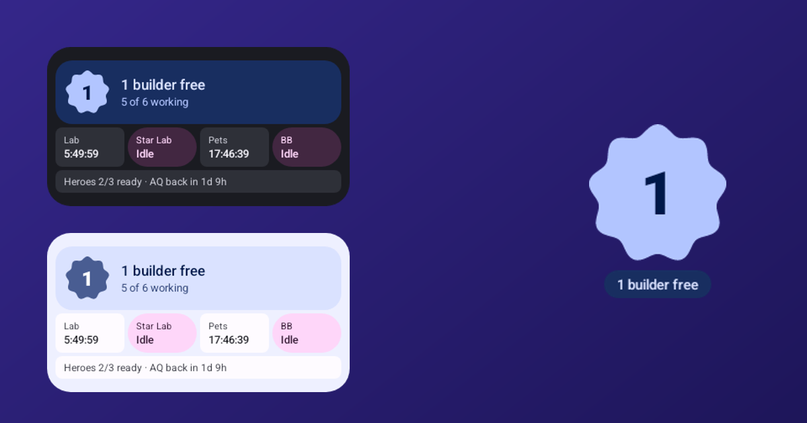
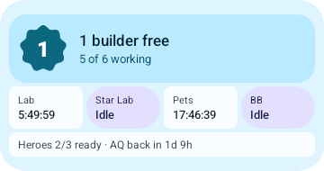
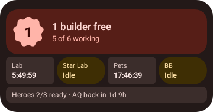

<p align="center">
  
</p>

<h1 align="center">Clash Timers: a Clash of Clans widget for Android</h1>

<p align="center"><a href="https://memehammad.github.io/clash-timers/">memehammad.github.io/clash-timers</a></p>

<p align="center">
  <b>Free builders, upgrade timers, lab research and hero status for Clash of Clans, right on your home screen.</b><br>
  Free, open source, no login, no ads.
</p>

<p align="center">
  <a href="https://apps.obtainium.imranr.dev/redirect?r=obtainium://add/https://github.com/memehammad/clash-timers"></a>
  &nbsp;
  <a href="https://github.com/memehammad/clash-timers/releases/latest"></a>
</p>

<p align="center">
  
</p>

Clash Timers is a **Clash of Clans widget** for Android. It shows how many builders are free,
counts down every running upgrade, and tells you the moment a builder, the laboratory or the
pet house is free, so you never leave a builder idle again.

No account, no login, no server: it reads the village export the game itself provides. Your
village data never leaves your phone; the only network request is an optional check for new
versions on GitHub.

## Why you'll like it

- **Free builders at a glance.** How many builders are idle, or a live countdown to the next one.
- **Every timer in one place.** Buildings, heroes, Gear Ups, Crafting Station modules,
  laboratory research, pets, Builder Base, the Builder's Apprentice and Clock Tower.
- **Notifications** the moment something finishes, plus an optional nudge if a builder sits idle.
- **Hero status.** Which heroes can attack, and when an upgrading one is back.
- **Boost planner.** See what a Builder or Research Potion, Builder Bite, Study Soup or Pet
  Potion would finish before you use it. Active boosts are counted in every timer.
- **At a Glance support** through [Smartspacer](https://github.com/KieronQuinn/Smartspacer):
  free builders and what finishes next, right above your clock.
- **Any size, your style.** From a 1x1 builder badge up to a full list, in Material You colours
  that follow your wallpaper, light or dark.
- **Several villages**, each with its own widget if you like.
- **Optional auto-import** with [Shizuku](https://shizuku.rikka.app/): tap Copy in Clash and
  the widget updates on its own.

<p align="center">
  
  <br>
  
  
</p>

## At a Glance (Smartspacer)

Add Clash Timers to the At a Glance bar above your clock with
[Smartspacer](https://github.com/KieronQuinn/Smartspacer). There's a card with free builders
and what finishes next, plus small chips for builders, lab and potions. You choose what each
one tracks and when it shows up, for example only when a builder is free or in the hour before
one finishes.

<p align="center"></p>

## Requirements

Android 12 or newer.

## Install

[](https://apps.obtainium.imranr.dev/redirect?r=obtainium://add/https://github.com/memehammad/clash-timers)

**With [Obtainium](https://github.com/ImranR98/Obtainium)** (recommended, gets
updates automatically): tap the badge above on your phone, or add
`https://github.com/memehammad/clash-timers` in Obtainium.

**Manually:** download `ClashTimers.apk` from the latest
[release](../../releases/latest) and open it on your phone. You may need to
allow installing apps from your browser or file manager.

## How to use it

1. In Clash of Clans, open **Settings → More Settings → Data Export** and tap
   **Copy**.
2. Open Clash Timers, or tap the widget. A new export on the clipboard is
   imported automatically. You can also share the text to the app.
3. Add the widget: long-press the home screen → **Widgets** → **Clash Timers**.

The export is a snapshot. Copy a new one after you start new upgrades or use
a potion.

### Auto-import (optional)

Android only lets the app in front read the clipboard. With
[Shizuku](https://shizuku.rikka.app/) running, Clash Timers can start a small
watcher with ADB-level rights that picks up new exports in the background:

1. Install and start Shizuku (wireless debugging works without a computer).
2. In Clash Timers, tap **Allow** on the Auto-import card, then **Turn on**.
3. From now on, tapping **Copy** in Clash is enough.

The watcher only reads the clipboard when it changes while Clash of Clans is
in front, and only hands over text that looks like a village export. Android
may show a short "pasted from your clipboard" notice when it does. After a
reboot, start Shizuku again; the watcher resumes by itself.

## How it works

The export lists each running upgrade with its remaining time at normal speed.
Clash Timers converts that into real finish times, applying any active boosts,
and schedules a notification for each. Names and upgrade durations come from a
bundled data file, so no game data is fetched from the internet.

The builder count is detected from your Builder's Huts and B.O.B. If it's ever
wrong, tap the builder card in the app to set it manually.

### Limitations

- Without auto-import, the app has to be opened (or the widget tapped) after
  copying an export, since Android only lets the app in front read the
  clipboard.
- Gold Pass time reductions and boosts used after the export aren't known
  until you export again.
- The export key names for Builder Bite, Study Soup and an active Clock Tower
  boost aren't documented and are matched by name. If one isn't picked up,
  please open an issue with an export taken while it's active.

## FAQ

**Is there a Clash of Clans widget for Android?**
Clash of Clans has no widget of its own. Clash Timers adds one: free builders, upgrade
timers, research and heroes on your home screen.

**Do I need to log in or give my Supercell ID?**
No. It uses the game's own Data Export (Settings → More Settings → Data Export → Copy).

**Is it safe? Can I get banned?**
It never touches the game and uses only what the game exports for you, the same data that
upgrade trackers use. Nothing is sent anywhere.

**Does it update by itself?**
Timers count down live. After you start new upgrades, copy a fresh export, or turn on
auto-import with Shizuku so it happens on its own.

**iPhone?**
Android only (Android 12 and newer).

## Changelog

See [CHANGELOG.md](CHANGELOG.md).

## Building from source

Releases are built automatically by GitHub Actions on every push to `main`
and tagged `v1.0.<build>`, matching the app version.

To build locally you need JDK 17 or 21 (Gradle 8.11 doesn't run on Java 25)
and the Android SDK, via Android Studio or the command-line tools with
`ANDROID_HOME` set.

```
./gradlew assembleRelease
# → app/build/outputs/apk/release/app-release.apk
```

If your default Java is newer, point Gradle at JDK 21, for example
`JAVA_HOME=/usr/lib/jvm/java-21-openjdk ./gradlew assembleRelease`.

### Signing

Without a key the release build is signed with the debug key. To sign with
your own key, place it at `app/release.jks` (alias and passwords
`clashtimers`, or change them in `app/build.gradle.kts`). In CI, store it
base64-encoded as the `SIGNING_KEY` repository secret. Never commit the key.

### Updating game data

`app/src/main/assets/coc_data.json` is generated from the
[clash-of-clans-data](https://github.com/chiefpansancolt/clash-of-clans-data)
package:

```
npm pack clash-of-clans-data && tar xzf clash-of-clans-data-*.tgz
python3 tools/build_table.py package/data app/src/main/assets/coc_data.json
```

## Credits

- Background clipboard access: [Shizuku](https://github.com/RikkaApps/Shizuku)
  and [HiddenApiBypass](https://github.com/LSPosed/AndroidHiddenApiBypass).
- Game data: [clash-of-clans-data](https://github.com/chiefpansancolt/clash-of-clans-data)
  by Christopher Pezza (MIT).

## License

[MIT](LICENSE). Game data, names and Clash of Clans itself remain the property
of Supercell.

## Disclaimer

This material is unofficial and is not endorsed by Supercell. For more
information see Supercell's
[Fan Content Policy](https://supercell.com/en/fan-content-policy/).
